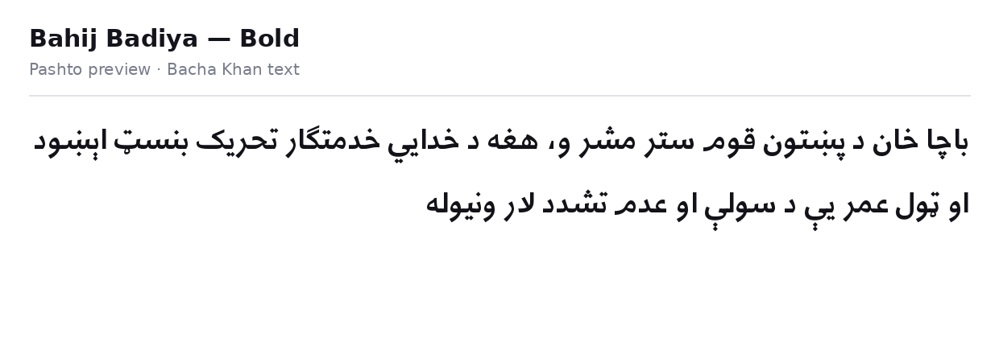
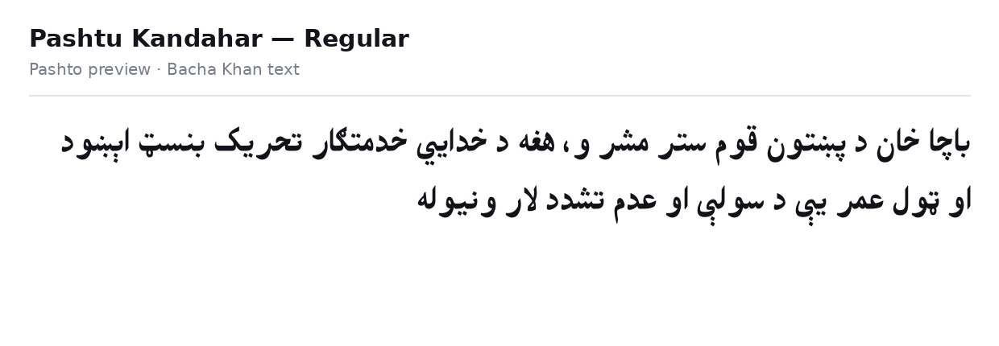
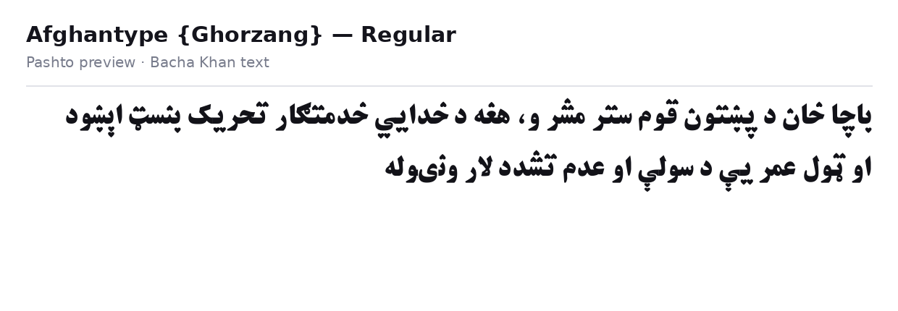
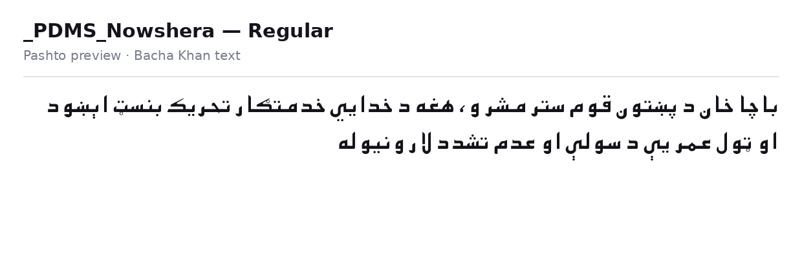
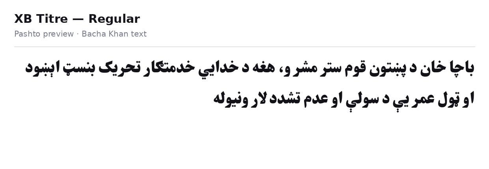
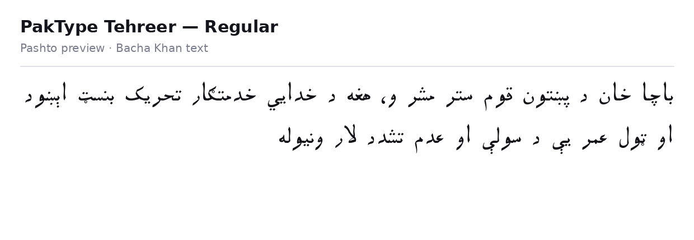
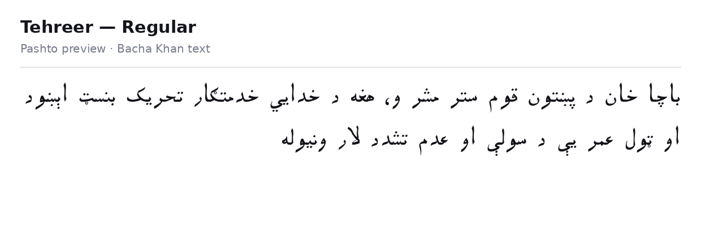
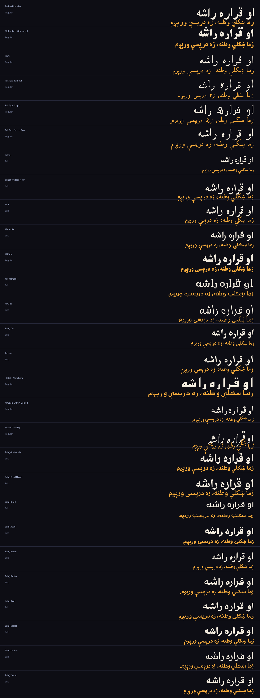

# Pashto Fonts — 131 Glyph-Verified Fonts (86 Families)

A curated library of **131 Pashto fonts** in **86 families** — every single one
**machine-tested for real Pashto glyph coverage** before it was allowed in.

Most "Pashto font" packs on the internet are Arabic or Urdu fonts with a new
name: they silently drop the Pashto-only letters. Every font in this repo
passed a glyph test (see [How these fonts were verified](#how-these-fonts-were-verified)),
so what you download here actually renders Pashto.

---

## Demo — one text, every font

Every preview card below shows the **same Pashto sentence about Bacha Khan**,
so the fonts can be compared fairly:

> باچا خان د پښتون قوم ستر مشر و، هغه د خدايي خدمتګار تحريک بنسټ اېښود او ټول عمر يې د سولې او عدم تشدد لار ونیوله
>
> *Bacha Khan was the great leader of the Pashtun nation; he founded the Khudai Khidmatgar movement and followed the path of peace and non-violence all his life.*

The sentence deliberately contains the letters bad fonts fail on:
**ټ ډ ږ ښ ڼ ې** — if a font can't shape Pashto, it shows immediately.

### Bahij Badiya — Bold

### Pashtu Kandahar

### Afghantype Ghorzang

### PDMS Nowshera

### XB Titre

### PakType Tehreer

### Tehreer

📁 **All 131 white preview cards** are in the [`previews/`](previews/) folder —
one per font, same text, white background.
A combined sheet of 28 fonts is also included:

---

## Top picks

| Use | Fonts |
|---|---|
| Titles & headings | **Pashtu Kandahar**, **Afghantype Ghorzang** |
| Heavy display | **PDMS Nowshera**, **XB Titre** |
| Chunky lyric / poster text | **Bahij Koodak**, **Bahij Jalal Bold** |
| Clean reading / body text | **Bahij Badiya**, **Lateef**, **PakType Naskh Basic** |
| Quranic text | **Al Qalam Quran Majeed**, **Bahij Uthman Taha** |

---

## How these fonts were verified

Collected 375 candidate TTF/OTF files from the sources below, then tested
every one programmatically:

**A font passes only if its character map contains ALL 11 Pashto-only letters**

ټ (U+067C) · ډ (U+0689) · ړ (U+0693) · ږ (U+0696) · ښ (U+069A) · ڼ (U+06BC) ·
ې (U+06D0) · ۍ (U+06CD) · ګ (U+06AB) · څ (U+0685) · ځ (U+0681)

**and** every distinct character of a real Pashto lyric text.

- **211 passed** → de-duplicated by file hash and family/style → **131 fonts / 86 families** in this repo.
- **Rejected as fake-Pashto** (0 of the 11 special letters): *Asad Regular* and *Markazi Text* — Arabic fonts wearing a Pashto label.

### Rendering notes

- Correct Pashto shaping needs a **HarfBuzz/raqm** text engine (what Android,
  iOS, Windows, Chrome and modern Linux use). Test in a real app, not a font viewer.
- **Awami Nastaliq** has full letter coverage but no shaping tables of its own —
  it relies on the system Nastaliq engine and needs generous line-height.
- **XW Zar Bold** renders correctly in HarfBuzz/Pango environments but breaks
  the libraqm shaper used by some image tools — noted so nobody thinks the file is corrupt.

---

## All 86 families

| Family | Styles | Files |
|---|---|---|
| _PDMS_Bukhari | Regular | 1 |
| _PDMS_Kalam | Regular | 1 |
| _PDMS_Kalash | Regular | 1 |
| _PDMS_Mehran | Regular | 1 |
| _PDMS_Multan | Regular | 1 |
| _PDMS_Nowshera | Regular | 1 |
| _PDMS_Sukkur | Regular | 1 |
| Adobe Arabic | Bold | 1 |
| Afghantype {Ghorzang} | Regular | 1 |
| Al Qalam Quran Majeed | Regular | 1 |
| Amiri | Bold, Regular | 2 |
| Awami Nastaliq | Regular | 1 |
| Bahij Aban | Bold | 1 |
| Bahij ASVCodar | Bold, Regular | 2 |
| Bahij Badiya | Bold, Regular | 2 |
| Bahij Badr | Bold, Regular | 2 |
| Bahij Baraem | Regular | 1 |
| Bahij Droid Naskh | Bold, Regular | 2 |
| Bahij Fedra Arabic | Bold, Regular | 2 |
| Bahij Firas | Regular | 1 |
| Bahij Greta Arabic | Bold, Medium, Regular | 3 |
| Bahij Hassan | Bold, Regular | 2 |
| Bahij Helvetica Neue | 45 Light, 55 Roman, 75 Bold | 3 |
| Bahij Homa | Bold | 1 |
| Bahij Insan | Bold, Regular, Thin | 3 |
| Bahij Jalal | Bold, Regular | 2 |
| Bahij Janna | Bold, Regular | 2 |
| Bahij Karim | Regular | 1 |
| Bahij Koodak | Bold, Regular | 2 |
| Bahij Koufiya | Bold, Regular | 2 |
| Bahij Lotus | Bold, Regular | 2 |
| Bahij Maged | Bold, Regular | 2 |
| Bahij Midan | Black, Regular | 2 |
| Bahij Mitra | Bold, Regular | 2 |
| Bahij Muna | Black, Bold, Regular | 3 |
| Bahij Myriad Arabic | Bold, Regular | 2 |
| Bahij Nassim | Bold, Regular | 2 |
| Bahij Nazanin | Bold, Regular | 2 |
| Bahij Palatino Arabic | Regular | 1 |
| Bahij Palatino Sans Arabic | Bold, Regular | 2 |
| Bahij Roya | Bold, Regular | 2 |
| Bahij SultanNahia | Regular | 1 |
| Bahij Tanseek Pro | Bold, Regular | 2 |
| Bahij TheSansArabic | Black, Bold, ExtraBold, ExtraLight, Light, Plain, SemiBold, SemiLight | 8 |
| Bahij Titr | Bold | 1 |
| Bahij Traffic | Bold, Regular | 2 |
| Bahij Uthman Taha | Bold, Regular | 2 |
| Bahij Yakout | Bold, Regular | 2 |
| Bahij Yekan | Bold, Regular | 2 |
| Bahij Zar | Bold, Regular | 2 |
| BPG Glaho Arial | Regular | 1 |
| Ghadeer | Regular | 1 |
| Harmattan | Bold, Regular | 2 |
| Jomhuria | Regular | 1 |
| Lateef | Bold, Regular | 2 |
| LateefGR | Regular | 1 |
| Mirza | Regular | 1 |
| PakType Ajrak | Regular | 1 |
| PakType Naqsh | Regular | 1 |
| PakType Naskh Basic | Regular | 1 |
| PakType Tehreer | Regular | 1 |
| Pashto Hamza | Regular | 1 |
| Pashtu Breshnik | Regular | 1 |
| Pashtu Kandahar | Regular | 1 |
| Pashtu pa' Storee | Regular | 1 |
| Pashtu Preghal | Regular | 1 |
| PDMS_SindhiMansehra | Regular | 1 |
| Riwaj | Regular | 1 |
| Scheherazade | Bold, Regular | 2 |
| Scheherazade New | Bold, Regular | 2 |
| Tahoma | Regular | 1 |
| Tehreer | Regular | 1 |
| XB Kayhan | Regular | 1 |
| XB Kayhan Sayeh | Regular | 1 |
| XB Khoramshahr | Bold | 1 |
| XB Riyaz | Regular | 1 |
| XB Roya | Bold | 1 |
| XB Sols | Bold | 1 |
| XB Titre | Regular | 1 |
| XM Traffic | Bold | 1 |
| XM Vahid | Bold | 1 |
| XM Yermook | Bold | 1 |
| XP Ziba | Bold | 1 |
| XW Zar | Bold | 1 |
| Yakout Linotype Light | Regular | 1 |
| Zarreen | Bold | 1 |

Font files are in the [`fonts/`](fonts/) folder.

---

## Install

**Windows:** select the `.ttf`/`.otf` files → right-click → *Install*
(or copy them into `C:\Windows\Fonts`).

**Android:** copy the files into your app's font folder, or use a font-installer
app / your phone's theme-font feature where supported.

**Linux:** copy into `~/.local/share/fonts/` then run `fc-cache -f`.

**macOS:** double-click each file → *Install Font*.

---

## Sources & licences

Fonts were collected from public sources: the Bahij pack
(bashirnoori.com), MTC Tutorials' Pashto font collection, the
`zahidaz/pashto_fonts` and `shamshadzaheer/pashtowebfonts` GitHub repos,
PakType, and Google Fonts (Lateef, Scheherazade New, Amiri, Harmattan).

⚖️ **Licences are mixed and belong to each family** — Google Fonts families
are OFL, PakType releases are GPL, the Bahij and MTC collections are distributed
as free downloads by their publishers. This repo is a research/typography
collection; **check each family's own licence before commercial use**.

---

*Built for Pashto lyric-video and typography work — every font in this repo
earned its place by passing the glyph test.*
